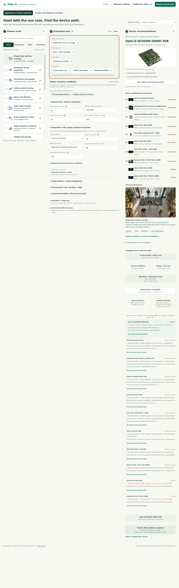
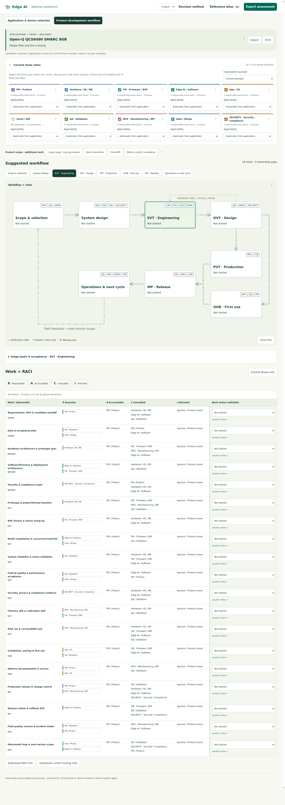

# Edge AI Hardware Blueprints

A visual planning workbench for startups and teams exploring a new AI product. Turn an application idea into an initial hardware shortlist, then map the work and responsibilities needed to build it.

**[Open the live demo](https://a0665x.github.io/Edge-AI-hardware-blueprints/?lang=en#selection)** · **[Product workflow](https://a0665x.github.io/Edge-AI-hardware-blueprints/?lang=en#delivery)**

## From an idea to a delivery plan

1. **Define the application.** Combine scenario, technique and requirement cards: vision, tracking, depth, robotics, speech and local language models.
   Conditions follow the selected scenario and deployment path; advanced settings expand on demand. Inapplicable values do not affect the evaluation.
2. **Explore hardware fit.** Review camera constraints, runtime compatibility, concurrent memory/compute, power and procurement bands. Inspect why each device is shortlisted or excluded.
3. **Plan product delivery.** Carry the assessment into a hardware/software workflow, identify missing or unnecessary functions, and assign internal or external ownership.
4. **Make responsibilities explicit.** Follow engineering, validation, production and operational feedback through a RACI table: Responsible, Accountable, Consulted and Informed.

The interface supports **English and Traditional Chinese**, contextual explanations, interactive workflow states, and JSON, CSV, SVG and draw.io exports.

## Screenshots

Full-page English captures. Click an image to view it at its original resolution.

### Application and device selection

[](docs/screenshots/selection-en.png)

### Product development and RACI

[](docs/screenshots/delivery-en.png)

## Run locally

Open `index.html` in a browser, or serve the project:

```sh
python3 -m http.server 8000
```

Then visit `http://localhost:8000/?lang=en`. No backend, API key or model download is required. Changing cards evaluates planning rules; it does not run AI inference. Current plans live in browser memory—export them before refreshing. Plan import is not implemented.

## Develop

Requires Python 3.10+ and Node.js 18+ for the checks.

```sh
python3 -m pip install -r requirements.txt
python3 edge-ai-guide/build.py
node edge-ai-guide/tests/engine.test.cjs
node edge-ai-guide/tests/ui.test.cjs
node edge-ai-guide/tests/workflow.test.cjs
python3 edge-ai-guide/tests/reference.test.py
```

`edge-ai-guide/src/` contains the selection UI, evaluation rules, bilingual content and product workflow. `build.py` generates the static HTML; `reference_view.py` builds the compact 13-chapter guide. To generate an optional offline single-file bundle, run `python3 edge-ai-guide/build.py --standalone`.

## Scope and credits

This is an **early planning aid**, not a hardware benchmark, purchase guarantee or certification tool. Rankings and resource envelopes need validation against the exact model, SDK, device configuration and real workload. RACI entries describe functions, not headcount; one person may cover multiple functions.

Project code is licensed under [MIT](LICENSE). Hardware product images and trademarks belong to their respective owners; their sources are recorded in [the image credits](edge-ai-guide/assets/hardware/sources.json). Scenario illustrations are conceptual, not deployment evidence. The reference guide links to model projects and platform documentation.
